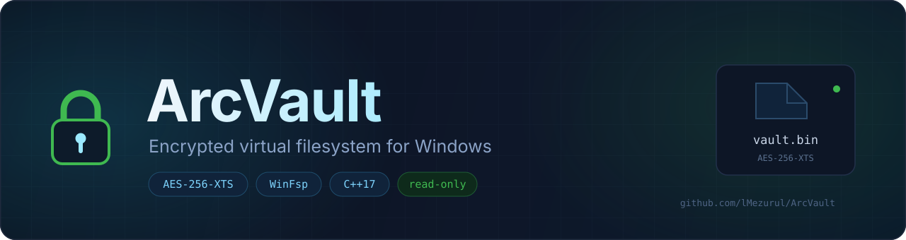
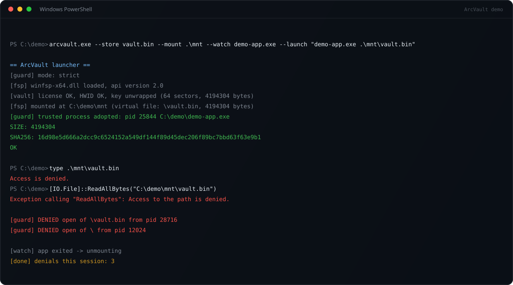
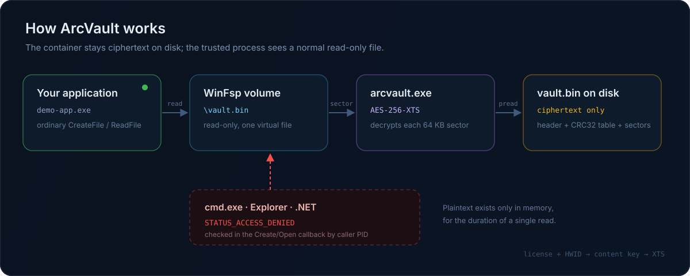

<div align="center">
  
</div>

<p align="center">
  <a href="#quick-start"></a>
  
  
  
  
</p>

**ArcVault keeps a file encrypted on disk and exposes it to exactly one process as an ordinary
read-only file.** The container is mounted through [WinFsp](https://winfsp.dev/), decrypted
sector by sector in memory, and every `Create`/`Open` request from any other process is rejected
with `STATUS_ACCESS_DENIED` — before a single byte is decrypted.

No kernel driver, no DLL injection, no patching the target application.

---

## Why

Shipping a data file to a user usually means handing over the plaintext. ArcVault flips that:

- **At rest it is ciphertext.** `vault.bin` is AES-256-XTS encrypted; there is no plaintext copy
  on disk, not even a temporary one.
- **At runtime it is a normal file.** Your application calls `CreateFileW`/`ReadFile` as usual —
  no custom SDK, no hooks, no code changes beyond the path.
- **Only your process can read it.** The file system checks the caller's PID (and the full image
  path) and denies everyone else, including Explorer, `cmd.exe`, .NET and Python.
- **It is bound to a license and a machine.** The content key is wrapped with
  `SHA-256(license ‖ HWID)`, so a container copied to another PC cannot be opened.

Typical uses: paid asset/content packs, license-gated desktop tools, protecting installed game
data from casual copying, and offline activation without a plaintext payload on disk.

## Demo



The trusted reader gets the exact SHA-256 of the original payload. `type`, `ReadAllBytes`,
Explorer and directory listing all fail with *Access is denied* — the denial happens in the
file system's open callback, so no plaintext is ever produced for them.

## How it works



1. **Pack.** `arcvault-encrypt` generates a random 64-byte XTS key, splits the file into 64 KB
   sectors and encrypts each one with AES-256-XTS (the sector index is the XTS data unit). The
   content key is wrapped with `SHA-256(license ‖ HWID)` and stored in the header. Every sector
   gets a CRC32; the header and the whole ciphertext get SHA-256.
2. **Unwrap.** At start the launcher reads `license.key`, computes the machine HWID
   (`MachineGuid` + system volume serial), derives the wrapping key and unwraps the content key.
   Wrong license or wrong machine — the key never exists in memory.
3. **Mount.** WinFsp creates a volume in the mount directory containing a single file. Reads are
   served straight from the container: `pread` the ciphertext sector, verify CRC32, decrypt XTS
   in place, copy the requested range to the caller. Plaintext lives only in that buffer.
4. **Guard.** WinFsp passes the caller's PID in the `Create` request. The launcher opens that
   process, compares the image name (and optionally a path substring), keeps a handle open so the
   PID cannot be recycled, and returns `STATUS_ACCESS_DENIED` for anyone else.
5. **Lifecycle.** The volume stays mounted while the trusted process runs and is unmounted a few
   seconds after it exits (configurable). The mount point disappears with it.

## Quick start

Requirements: Windows 10/11, [WinFsp](https://winfsp.dev/) 2.x, a C++17 compiler (the build
script uses [zig](https://ziglang.org/) as a self-contained clang + mingw-w64 toolchain).

```bat
winget install WinFsp.WinFsp
winget install zig.zig

git clone https://github.com/lMezurul/ArcVault
cd ArcVault
build.bat
```

Create a license, pack a file, verify it, mount it:

```bat
:: 1. demo license (in production issue keys from your own server/bot)
arcvault-encrypt genkey license.key

:: 2. pack assets.pak into an encrypted container on THIS machine
arcvault-encrypt pack assets.pak vault.bin license.key

:: 3. full decrypt-all check (optional, useful in CI)
arcvault-encrypt verify vault.bin license.key

:: 4. mount and start the trusted app
arcvault.exe --store vault.bin --mount .\mnt --license license.key ^
             --watch demo-app.exe --launch "demo-app.exe .\mnt\vault.bin"
```

`.\mnt\vault.bin` now behaves like a normal 4 MB read-only file — for `demo-app.exe` only.
Try `type .\mnt\vault.bin` in another terminal: *Access is denied*.

> **Packing happens on the target machine.** The content key is wrapped with *that* machine's
> HWID, so a container built on your PC will not open on a customer's PC. The intended flow is:
> your installer/first-run step receives the payload, packs it locally, and deletes the
> plaintext. This is what makes the installed content non-copyable.

## CLI

### `arcvault-encrypt.exe`

| command | description |
|---|---|
| `pack <input> <vault.bin> [license.key]` | encrypt a file into a container |
| `verify <vault.bin> [license.key]` | decrypt everything and compare SHA-256 |
| `info <vault.bin>` | print the header without decrypting |
| `genkey [license.key]` | create a demo license key |
| `selftest-xts` | XTS known-answer helper |

### `arcvault.exe`

| argument | meaning |
|---|---|
| `--watch <exe>` | **required**: image name of the only process allowed to open the file |
| `--store <file>` | container path (default `vault.bin`) |
| `--mount <dir>` | mount point directory, created on start and removed on unmount |
| `--drive <X:>` | mount as a drive letter instead of a directory |
| `--name <file>` | name of the virtual file (default `vault.bin`) |
| `--license <file>` | license key file (default `license.key`) |
| `--watch-path <text>` | optional substring of the trusted process full path |
| `--launch <url\|cmd>` | start the app after mounting (URL via shell, otherwise `CreateProcess`) |
| `--wait-app <sec>` | how long to wait for an app started by URL (default 120) |
| `--idle-exit <sec>` | unmount N seconds after the app exits (default 10) |
| `--guard off` | disable the PID check — **demo/testing only** |
| `--verify-store` | verify the full ciphertext SHA-256 before mounting |
| `--trace` | write a WinFsp request trace to `fsp-trace.log` |

## Container format

```
offset  size  field
0       4     magic "ACVF"
4       2     version (1)
6       2     header size (176)
8       4     sector size (65536)
12      4     flags (bit 0: key bound to license + HWID)
16      8     original size
24      8     sector count
32      4     data offset
40      32    SHA-256 of plaintext        (audit / verify tool)
72      32    SHA-256 of ciphertext       (fast mount-time check)
104     64    wrapped content key          (XTS key XOR SHA-256 stream)
168     4     header CRC32
172     4     reserved
176     n*4   CRC32 per sector
...     n*64K ciphertext (AES-256-XTS, data unit = sector index)
```

XTS follows IEEE 1619 and is cross-checked against OpenSSL `aes-256-xts` (`selftest-xts`).
A single corrupted sector is detected by its CRC and reported as `STATUS_FILE_CORRUPT_ERROR`.

## Security model

**Protects against**

- copying `vault.bin` to another machine — the key is wrapped with the license and the local HWID;
- reading/copying the mounted file from any other process, including Explorer, `cmd.exe`, .NET,
  Python, archivers and "grab the file while the game/app is running" tools;
- silent tampering with the container — per-sector CRC32 + SHA-256 header and ciphertext;
- running the content without the launcher: there is no plaintext to run.

**Does not protect against**

- a process with administrator/SYSTEM rights reading the memory of your application while the
  plaintext is in use (this is true for any scheme that does not hook the renderer);
- screen capture, screenshots, or re-encoding what is already displayed;
- kernel-mode attackers or a debugger attached to the trusted process;
- code injection into the trusted process itself — the guard trusts the process, not its integrity.

The license check in this repository is deliberately a stub (`ARC-XXXX-…` with a CRC group).
For production, replace `acv_license_valid()` and `cmd_genkey()` with signed keys or a server
call — those two functions are the only extension points.

## Performance

Measured on Windows 11, 256 MB container, single-threaded 8 KB reads:

| operation | throughput |
|---|---|
| pack (`AES-256-XTS`, 64 KB sectors) | ~200 MB/s |
| read through the mounted volume | ~35 MB/s |

The read path decrypts a whole 64 KB sector per request, so 8 KB reads pay ~8× the crypto work.
A sector cache is the obvious next optimization; for streaming large assets the current numbers
are already well above typical HDD/network delivery rates.

## Project layout

```
src/arcvault.cpp        WinFsp volume, process guard, mount lifecycle
src/crypto.cpp          AES-256-XTS, SHA-256, CRC32, HWID, key wrapping (CNG)
src/encrypt_tool.cpp    pack / verify / info / genkey
src/demo_app.cpp        tiny trusted reader used by the test
src/vault.h             container header layout
test/run_e2e.ps1        end-to-end test (packs, mounts, checks denials, unmounts)
third_party/winfsp/     upstream WinFsp headers (compile time only)
```

## Tests

```powershell
powershell -ExecutionPolicy Bypass -File test\run_e2e.ps1
```

The script generates a random 4 MB payload, packs it, mounts the container, checks that
`cmd.exe`, .NET and directory listing are denied, verifies that the trusted reader gets the exact
SHA-256, rejects a wrong license and a tampered container, and confirms a clean unmount.

```
[PASS] mount point created
[PASS] cmd.exe read denied
[PASS] .NET read denied
[PASS] directory listing denied
[PASS] trusted process read the plaintext
[PASS] launcher exited cleanly
[PASS] mount point removed
== E2E finished, failures: 0 ==
```

## Implementation notes

A few things that were not obvious while building this:

- **WinFsp 2.x is SxS.** The DLL is loaded from `SxS\sxs.<id>\bin` (path in
  `HKLM\Software\WOW6432Node\WinFsp\SxsDir`); a 64-bit process must read the `WOW6432Node` key
  explicitly. The device suffix is taken from `winfsp.sxs` next to the DLL.
- **`FspFileSystemCreate` can fail** on some installations because its internal device open is
  rejected. `CreateFileSystemManual()` builds the same `\Device\WinFsp.Disk+<sxs>\VolumeParams=…`
  path byte by byte and fills the public `FSP_FILE_SYSTEM` struct from the exported
  `FspFileSystemOp*` entry points.
- **`Interface->Overwrite` must be non-NULL**, otherwise every open returns
  `STATUS_INVALID_DEVICE_REQUEST`.
- **Security descriptors** need owner/group and specific rights (`FA`), because the user-mode
  access check does not expand generic rights (`GA`) inside ACEs.

## Credits

- [WinFsp — Windows File System Proxy](https://github.com/winfsp/winfsp), Copyright (C) Bill
  Zissimopoulos. Used as a user-mode file system framework; headers are bundled for building.
- AES-256-XTS, SHA-256 and random generation come from Windows CNG (`bcrypt.dll`).

## License

Project code: [MIT](LICENSE). The bundled WinFsp headers are GPLv3 with the WinFsp FLOSS
exception — see [`third_party/winfsp/LICENSE.txt`](third_party/winfsp/LICENSE.txt).

---

## Кратко по-русски

**ArcVault** — шифрованный контейнер, который монтируется как обычный файл только для чтения
через WinFsp. На диске лежит только шифртекст (AES-256-XTS, посекторно), ключ завёрнут на
лицензию и HWID машины, а открыть файл может только тот процесс, который указан в `--watch`.
Остальные — `cmd`, Explorer, .NET, Python — получают `ACCESS_DENIED` ещё на этапе открытия.

- Без драйвера ядра, без инъекций в процесс игры/приложения.
- Контейнер нельзя просто скопировать на другой ПК — не развернётся ключ.
- Подмена сектора ловится CRC32, повреждение заголовка — CRC + SHA-256.
- Упаковка делается на машине пользователя (при установке/первом запуске), чтобы ключ был
  привязан к её HWID.
- Быстрый старт: `build.bat`, затем `arcvault-encrypt genkey/pack/verify` и `arcvault.exe`.

Честно о границах: это не защита от администратора, читающего память процесса, не защита от
скриншотов и не DRM для уже отрисованного контента.
